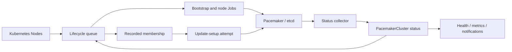

# Two Node with Fencing

Pacemaker manages external etcd, kubelet, and fencing. Kubernetes control-plane
Node identities define desired membership; readiness only selects Job executors.

The lifecycle queue serializes membership decisions. Jobs and their Pods serialize
execution across CEO restarts. Health reporting has its own queue; certificate
watching runs independently on each host.

- [reconciliation.md](reconciliation.md): recorded membership, removal guards,
  repair checkpoints, retries, and cleanup added by lifecycle part 3.
- [lifecycle-manager.md](lifecycle-manager.md): controller startup, executor
  selection, status collection, and alert-agent reconciliation.
- [job-controllers.md](job-controllers.md): bootstrap and the shared Job framework.
